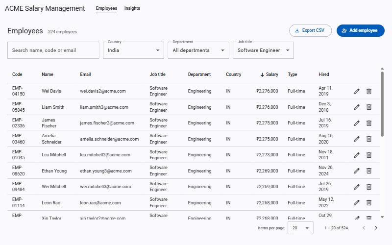
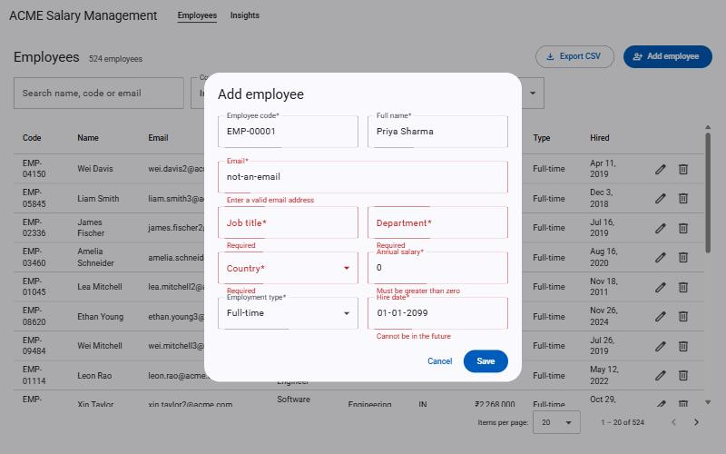
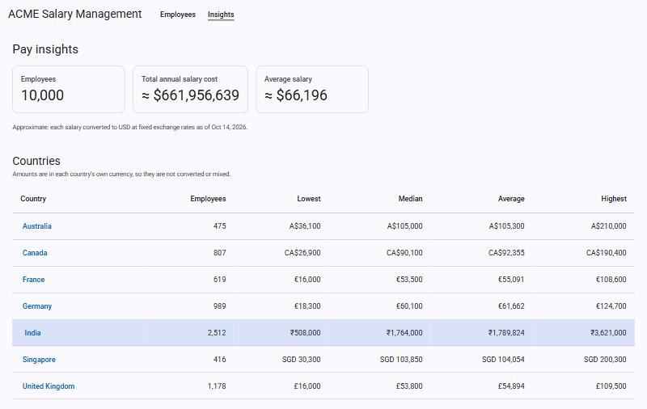
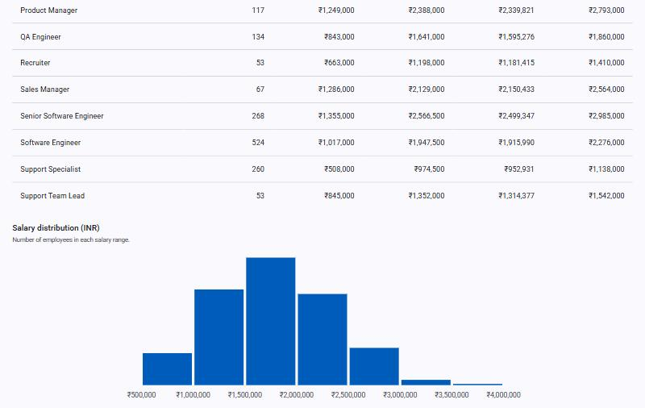

# ACME Salary Management

[](https://github.com/SarthakShejole01/acme-salary-management/actions/workflows/ci.yml)

Web-based salary management for ACME's HR team: maintain salary data for ~10,000 employees across eight countries, and answer questions about how the organisation pays people, such as *"what is the median software-engineer salary in India?"*, without spreadsheets.

|  |  |
|---|---|
| **Live demo** | [https://acme-salary-management-grfk.onrender.com](https://acme-salary-management-grfk.onrender.com), on Render with a Neon database. Protected by a shared login; the credentials are given separately, never in this repository. The free instance sleeps when idle, so the first request after a pause can take about a minute. |
| **Demo video** | _Added with the submission._ |
| **Scope & exclusions** | [`docs/requirements.md`](docs/requirements.md) |

## What it looks like

**Find and maintain employees**: server-side paging, sorting and search over 10,000 rows, filters by country, department and job title, CSV export of exactly what is filtered.



**Validation that matches the server**: the form checks the same rules as the API (required fields, lengths, email, salary above zero with at most two decimals, hire date not in the future) and shows server-side conflicts, such as a duplicate email, on the right field.



**Pay insights**: totals in USD are marked approximate and carry the exchange-rate date; the country comparison stays in each country's own currency, so nothing is silently converted or mixed.



**Drill-down**: pick a country for its per-job-title statistics and a salary distribution.



## Features

| | |
|---|---|
| Employee records | Create, view, edit, delete; unique employee code and email; currency follows the country. |
| Find employees | Search (name, code, email), filter, sort, page: all on the server. |
| Country insights | Headcount, lowest, highest, average and exact median, in local currency. |
| Job-title insights | The same statistics per job title within a country. |
| Salary distribution | Histogram with round bucket edges (₹5 lakh or £10,000 steps), empty buckets included. |
| Organisation summary | Total cost and average in USD at fixed, dated rates, clearly labelled approximate. |
| CSV export | Streams the filtered list; Excel-friendly and safe against formula injection. |
| Seed data | 10,000 deterministic, realistic employees, loaded in about a second. |

## Decisions worth knowing about

Each has a decision record or a note in [`docs/plan.md`](docs/plan.md):

- **Money is never a float.** `BigDecimal` in a `Money` value object, `numeric(14,2)` in PostgreSQL; salaries stay in local currency and are only converted (once, exactly, then rounded once) for organisation-wide figures, using European Central Bank reference rates of 14 Oct 2026 stored in a table. [ADR 003](docs/adr/003-local-currency-with-fixed-exchange-rates.md)
- **Aggregation happens in SQL**, never by loading entities. The median is exact `numeric` (`percentile_disc` on both ends), not `percentile_cont`'s floating point. [ADR 004](docs/adr/004-aggregations-in-sql.md)
- **PostgreSQL, tested with PostgreSQL.** The SQL tests run against a real database through Testcontainers; there is no H2. [ADR 002](docs/adr/002-postgresql-over-sqlite.md)
- **One deployable image**: Angular is built into the Spring Boot jar. [ADR 001](docs/adr/001-single-deployable-spring-boot-angular.md)
- **Spring Boot 4 and Angular Material**, because Boot 3 is out of open-source support and PrimeNG is now commercially licensed. [ADR 006](docs/adr/006-spring-boot-4.md), [ADR 007](docs/adr/007-angular-material-over-primeng.md)
- **One shared login, failing closed.** HTTP basic auth protects everything but the health check; the hosted profile refuses to start without it. Real access control (SSO, roles) is the first roadmap item. [ADR 005](docs/adr/005-no-authentication-in-v1.md)

## How it was built

Test-first: a failing `test:` commit, then the `feat:` commit that makes it pass, small and frequent, one pull request per change into `dev`; CI (backend with Testcontainers, frontend tests and build) runs on every push. [`CLAUDE.md`](CLAUDE.md) is the working agreement given to the AI coding agent, and [`docs/ai-usage.md`](docs/ai-usage.md) records what AI was used for and, more usefully, **every mistake that was caught and how**.

## Tech stack

| Layer      | Choice |
|------------|--------|
| Backend    | Java 21, Spring Boot 4, Spring Data JPA (Hibernate), JDBC for aggregations and seeding, Flyway, Spring Security (basic auth), Gradle (Kotlin DSL) |
| Database   | PostgreSQL 16 |
| Frontend   | Angular 22 (standalone components, signals, RxJS), TypeScript strict, Angular Material, plain-SVG chart |
| Testing    | JUnit 5, AssertJ, Mockito, Testcontainers · Vitest with Angular testing utilities and Material harnesses |
| CI/CD      | GitHub Actions · Docker (single multi-stage image) · Render + Neon |

## Performance

Measured on a laptop with the 10,000 seeded employees (details and method in [`docs/performance.md`](docs/performance.md)):

| | Target | Measured |
|---|---|---|
| List, search and filter | < 300 ms | 20–56 ms |
| Insight queries | < 500 ms | 9–18 ms |
| Full CSV export (10,000 rows) | n/a | about 0.3 s |
| Seeding 10,000 employees | seconds | about 0.9 s |
| Container memory under load | n/a | 279 MB peak, within a 512 MB limit |

## Repository layout

```
backend/    Spring Boot API (feature packages: employee, insights, currency, seed, common)
frontend/   Angular application (core/ services, features/, shared/)
docs/       Requirements, architecture, decision records, plan, performance, deployment, AI usage
Dockerfile  Multi-stage build of the single image
render.yaml Render blueprint for the hosted instance
CLAUDE.md   Working agreement for the AI coding agent
```

## Getting started

**Prerequisites:** Java 21, Node 24.15+ (Angular 22), Docker Desktop.

```bash
# 1. Database: PostgreSQL 16 on localhost:5433 (5433 avoids clashing with a local install)
docker compose up -d

# 2. Backend: http://localhost:8080 (health: /actuator/health)
cd backend && ./gradlew bootRun

# 3. Frontend: http://localhost:4200, proxies /api to the backend
cd frontend && npm ci && npm start
```

**Seed data**: 10,000 realistic, deterministic employees (the same data every run):

```bash
cd backend && ./gradlew bootRun --args='--spring.profiles.active=seed'          # skips if employees exist
cd backend && ./gradlew bootRun --args='--spring.profiles.active=seed --reset'  # replaces all employees
```

**Run the production image** (Angular + Spring Boot in one container, on http://localhost:8080):

```bash
docker compose --profile app up --build     # builds the image, starts PostgreSQL and the app
```

The image is built by the multi-stage [`Dockerfile`](Dockerfile): Node builds the Angular app, Gradle builds the backend with the Angular files inside, and a small JRE image runs it as a non-root user.

**Configuration** comes from environment variables; defaults work out of the box. Copy `.env.example` to `.env` (git-ignored) to override `DB_*` settings. Setting `APP_SECURITY_USERNAME` and `APP_SECURITY_PASSWORD` puts the shared login in front of everything except `/actuator/health`; locally the app is open.

**Deploy** (Render + Neon, free plans): follow [`docs/deployment.md`](docs/deployment.md); [`render.yaml`](render.yaml) is the blueprint.

## Tests

```bash
cd backend  && ./gradlew test                       # 205 tests; needs Docker running (Testcontainers starts PostgreSQL)
cd frontend && npm test -- --watch=false            # 84 tests
```

Backend: unit tests for the domain (money, salary model, seed generator, histogram bins, CSV), `@WebMvcTest` for every HTTP contract, Testcontainers for every SQL query and for the whole application including the login. Frontend: services with `HttpTestingController`, components with Angular Material harnesses, no real network, clock or sleeps.

## Documentation

- [Requirements](docs/requirements.md), including what is deliberately out of scope
- [Architecture](docs/architecture.md)
- [Architecture decision records](docs/adr/)
- [Implementation plan and decisions log](docs/plan.md)
- [Performance notes](docs/performance.md)
- [Deployment (Render + Neon)](docs/deployment.md)
- [How AI tools were used](docs/ai-usage.md)

## What is not built (on purpose)

Excel/CSV import, salary history and audit trail, SSO and roles, bonuses and equity, payroll. The reasoning for each, and the roadmap, are in [`docs/requirements.md`](docs/requirements.md).
