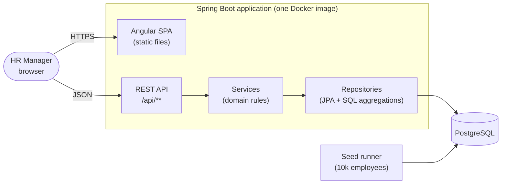

# Architecture

## Overview

A single deployable application: an Angular single-page app served by a Spring Boot backend, which owns a PostgreSQL database.



## Backend structure — package by feature

```
backend/src/main/java/com/acme/salary/
├── employee/     Employee entity, repository, service, controller, DTOs
├── insights/     Read-only aggregate queries and endpoints
├── currency/     Money value object, exchange rates, conversion
├── seed/         Deterministic employee generator + batch seed runner
└── common/       Error handling (RFC 7807 ProblemDetail), paging DTOs, config
```

Rules:

- Controllers are thin: map HTTP ⇄ DTOs and delegate. No business logic.
- Services hold the domain rules and are unit-tested without Spring.
- Entities never leave the service layer; the API speaks DTOs.
- Aggregations (`GROUP BY`, `percentile_cont`) run in SQL — the database is built for this, and it avoids loading 10k rows into memory.
- Schema changes go through Flyway migrations only.

## Frontend structure

```
frontend/src/app/
├── core/         HTTP services, interceptors, error handling
├── features/
│   ├── employees/   list (server-paged table + filters), form dialog
│   └── insights/    dashboard: country table, job-title drill-down, distribution, summary
└── shared/       reusable components, pipes (e.g. money formatting)
```

- Signals for component state; RxJS for HTTP and debounced search.
- All list filtering, sorting and paging happen on the server.

## API (planned)

| Method | Path | Purpose |
|--------|------|---------|
| GET | `/api/employees?page&size&sort&search&country&department&jobTitle` | Paged, filtered list |
| GET | `/api/employees/{id}` | One employee |
| POST | `/api/employees` | Create |
| PUT | `/api/employees/{id}` | Update |
| DELETE | `/api/employees/{id}` | Delete |
| GET | `/api/employees/export.csv?…filters` | CSV export of filtered list |
| GET | `/api/insights/countries` | Per-country headcount, min/max/avg/median |
| GET | `/api/insights/countries/{code}/job-titles` | Per-title stats within a country |
| GET | `/api/insights/countries/{code}/distribution` | Salary histogram buckets |
| GET | `/api/insights/summary` | Org-wide totals in USD (approximate) |
| GET | `/api/reference-data` | Countries, departments, job titles for dropdowns |

### Errors

All errors are RFC 7807 `application/problem+json` bodies. Field-level problems add an `errors` list:

```json
{ "status": 409, "title": "Conflict", "detail": "Email priya@acme.com is already in use",
  "errors": [ { "field": "email", "message": "Email priya@acme.com is already in use" } ] }
```

| Status | When |
|--------|------|
| 400 | Bean Validation failure (one entry per field), business rule (e.g. future hire date), malformed JSON / unknown enum value |
| 404 | Employee id does not exist |
| 409 | Employee code or email already used; also a concurrent duplicate caught by a database constraint (generic detail, no SQL exposed) |

## Data model (initial)

```
employee                                   -- Flyway V1
  id               bigint generated by default as identity PK
  employee_code    varchar(20)   NOT NULL  UNIQUE (uk_employee_code)
  full_name        varchar(200)  NOT NULL
  email            varchar(254)  NOT NULL  UNIQUE on lower(email) (uk_employee_email)
  job_title        varchar(100)  NOT NULL
  department       varchar(100)  NOT NULL
  country_code     varchar(2)    NOT NULL  -- ISO 3166-1 alpha-2, Java enum Country
  currency         varchar(3)    NOT NULL  -- ISO 4217, derived from country
  salary           numeric(14,2) NOT NULL  CHECK (salary > 0)
  employment_type  varchar(20)   NOT NULL  CHECK IN (FULL_TIME, PART_TIME, CONTRACTOR)
  hire_date        date          NOT NULL
  created_at, updated_at  timestamptz NOT NULL DEFAULT now()  -- set from the injected Clock by JPA auditing

exchange_rate                              -- planned (Flyway V2)
  currency         varchar(3) PK
  usd_rate         numeric(18,8) NOT NULL   -- 1 unit of currency = usd_rate USD
  effective_date   date NOT NULL

Indexes: (country_code, job_title) -- also serves country-only filters, (department)
```

## Testing strategy

| Level | Scope | Tools |
|-------|-------|-------|
| Unit (bulk of tests) | Money, conversion, validation rules, seed generator, insight mapping | JUnit 5, AssertJ, Mockito |
| Web slice | Request validation, status codes, error bodies | `@WebMvcTest` |
| Persistence | Aggregate SQL against a small known dataset | `@DataJpaTest` + Testcontainers (PostgreSQL) |
| Frontend | Services, form validation, table behaviour | Angular unit tests |

See [`adr/`](adr/) for the reasoning behind the main decisions.
